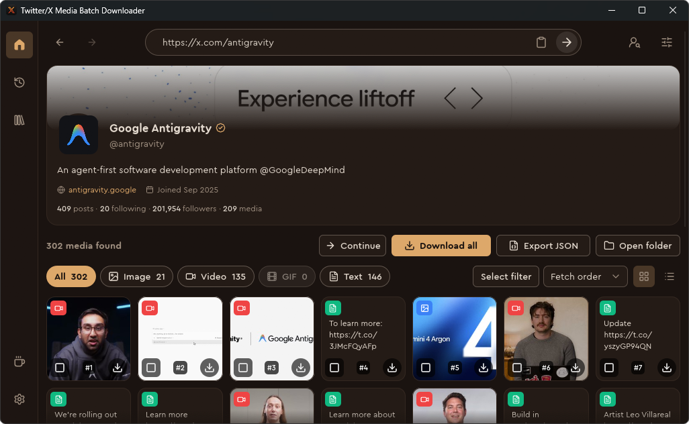
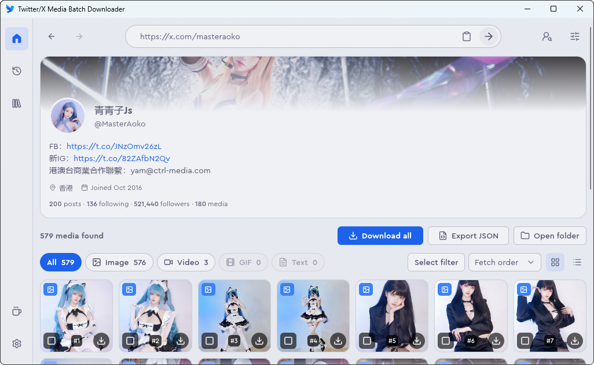
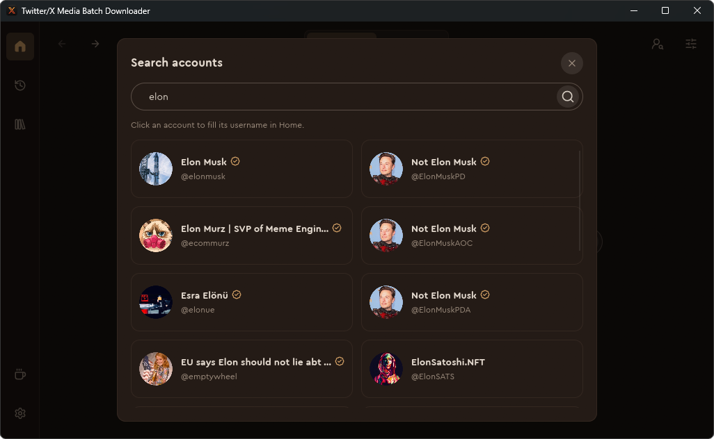
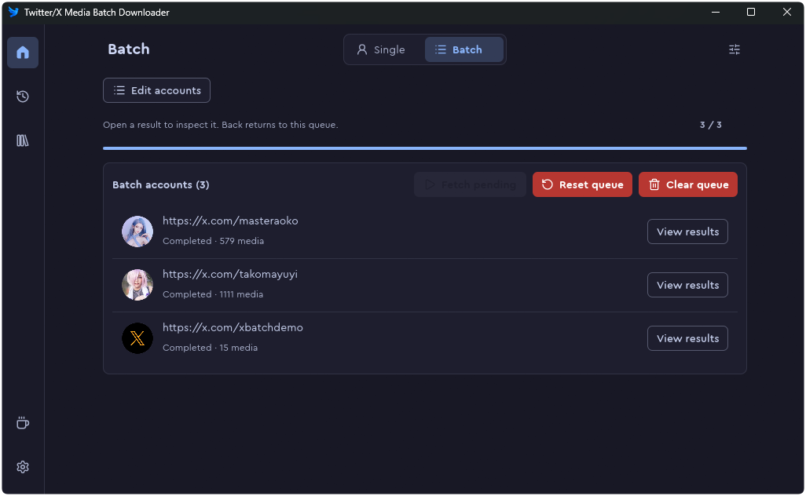
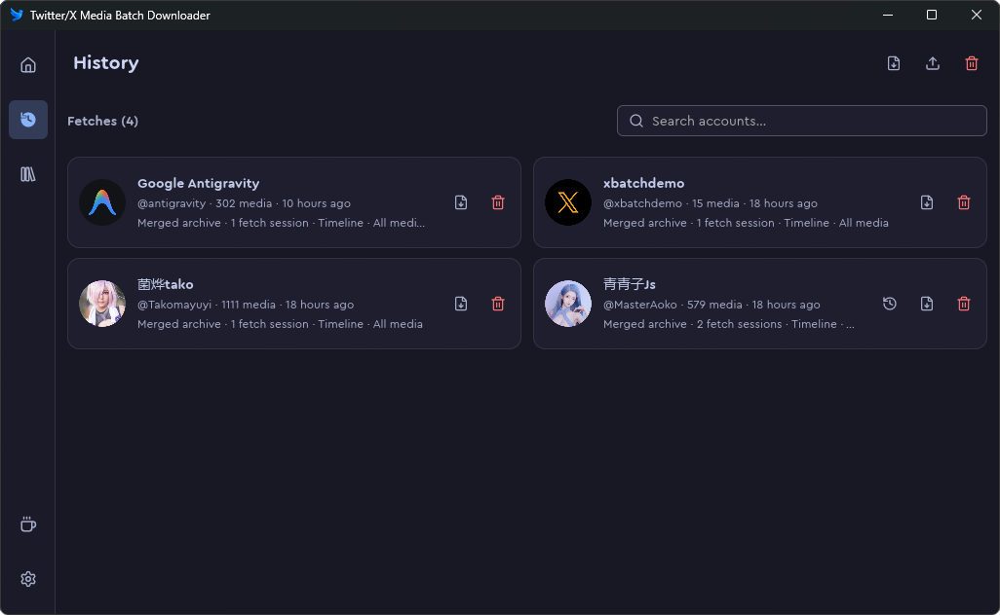
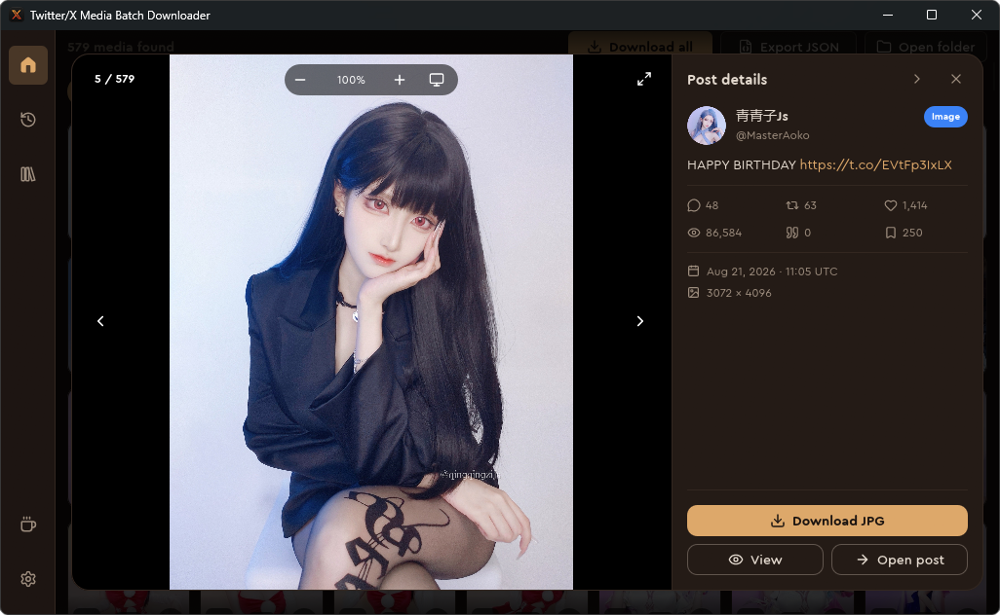

### `Twitter/X Media Batch Downloader`<br><sub><sup>Downloads original-quality images and videos from Twitter/X accounts.</sup></sub>

[](https://github.com/afkarxyz/Twitter-X-Media-Batch-Downloader/stargazers)
[](https://github.com/afkarxyz/Twitter-X-Media-Batch-Downloader/releases)
[](https://github.com/afkarxyz/Twitter-X-Media-Batch-Downloader/releases/latest)
[](https://github.com/afkarxyz/Twitter-X-Media-Batch-Downloader/releases/latest)
[](https://github.com/afkarxyz/Twitter-X-Media-Batch-Downloader/releases/latest)
[](https://github.com/afkarxyz/Twitter-X-Media-Batch-Downloader/releases/latest)

<br>

## Screenshots

| Dark | Light |
| --- | --- |
|  |  |

| Account Search | Batch Queue |
| --- | --- |
|  |  |

| History | Media Preview |
| --- | --- |
|  |  |

### [Download](https://github.com/afkarxyz/Twitter-X-Media-Batch-Downloader/releases)

- If you're familiar with userscripts, install it [**here**](https://greasyfork.org/en/scripts/523157)

- To install the Chrome extension version, click [**here**](https://chromewebstore.google.com/detail/cboceolmgkoobpfjiojkigmihijfgmdo)

- Also available on the web at [**TwitterDL.app**](https://twitterdl.app)

## Troubleshooting

### Linux

```sh
chmod +x TwitterXMediaBatchDownloader.AppImage
./TwitterXMediaBatchDownloader.AppImage
```

If it does not start, install FUSE (`sudo apt install fuse3`) or run it with
`--appimage-extract-and-run`.

### macOS

After copying the app out of the DMG, run this once, or macOS reports that the app
is damaged:

```sh
xattr -dr com.apple.quarantine /Applications/TwitterXMediaBatchDownloader.app
```

## How to Obtain Auth Token

> [!Warning]
> - I suggest not using the **main account** to obtain the token.
> - You can use https://temp-mail.io to register a Twitter account.
> - Using an auth token or cookies has the potential to get the **account suspended.**
> - If too many media files are fetched, it may trigger a **rate limit**, and the media retrieval will fail.

1. Go to [Twitter's website](https://www.x.com/)
2. Log into your account
3. Open the Developer Tools by pressing <kbd>F12</kbd>
4. Navigate to the **Application** tab, then select **Storage → Cookies**
5. Find and copy the `auth_token` value
6. Do not log out of your account, as a new `auth_token` will be generated by Twitter

